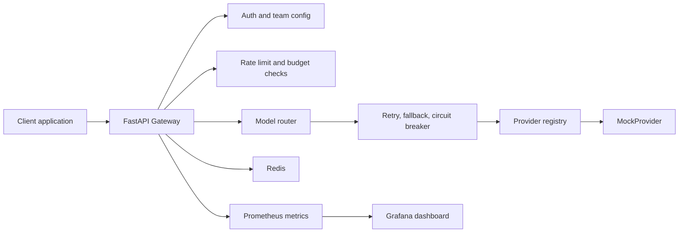

# LLM Gateway

Production-style API gateway for centralizing LLM access across teams, models, budgets, rate limits, retries, fallback routing, circuit breakers, and observability.

This project is an AI infrastructure backend, not a chatbot UI. It demonstrates how a company could put a control plane in front of LLM providers so application teams do not need to solve authentication, routing, reliability, and monitoring separately in every service.

The repository now includes a React developer console for exercising the gateway. After `docker compose up --build`, open `http://localhost:8080`. See [docs/ui-runbook.md](docs/ui-runbook.md) for local test controls, capability boundaries, and the Grafana view.

## Overview

LLM Gateway exposes an OpenAI-style chat completion endpoint:

```http
POST /v1/chat/completions
```

Clients call the gateway with a team API key and a model alias such as `smart-chat` or `cheap-chat`. The gateway authenticates the team, verifies model access, enforces request budgets and rate limits, routes the request to a configured provider target, applies retry/fallback/circuit-breaker behavior, records usage and estimated cost, and emits Prometheus metrics.

The current implementation uses a deterministic `MockProvider` so the full system can be tested and demonstrated locally without paid provider calls or real LLM API keys.

## Motivation

Direct LLM provider integrations become hard to operate as teams and applications multiply:

- API keys spread across services.
- Teams can exceed budgets without a central control point.
- Provider failures become application failures.
- Usage, cost, latency, retries, and errors are difficult to compare across providers.
- Each team may implement different retry, fallback, and access-control logic.

LLM Gateway solves those problems by making LLM access a centrally governed backend service.

## Features

- FastAPI application with OpenAI-style chat completion route.
- Bearer API key authentication with team lookup.
- Per-team model access control.
- YAML-based team, pricing, route, fallback, budget, and circuit-breaker configuration.
- Provider abstraction with `BaseProvider`, `ProviderTarget`, `ProviderRegistry`, and deterministic `MockProvider`.
- Redis-backed request-per-minute rate limiting.
- Redis-backed daily and monthly budget tracking.
- Estimated cost tracking from configured per-model prices.
- Retry logic with exponential backoff and jitter.
- Fallback routing across configured provider targets.
- Circuit breaker with `closed`, `open`, and `half_open` states.
- Provider health endpoint based on configured targets and circuit state.
- Structured JSON logs with request IDs.
- Prometheus metrics for requests, latency, tokens, estimated cost, retries, fallbacks, provider errors, rate limits, budget blocks, and circuit state.
- Docker Compose stack for Gateway, Redis, Prometheus, and Grafana.
- Smoke, load, unit, and integration tests.

## Architecture



See [docs/architecture.md](docs/architecture.md) for the full architecture, request lifecycle, provider routing, retry/fallback, circuit-breaker, and Docker deployment diagrams.

## Technologies

| Area | Technology |
| --- | --- |
| Language | Python 3.11+ |
| API framework | FastAPI |
| Validation | Pydantic |
| HTTP client | httpx |
| Config | YAML |
| Rate limiting and budgets | Redis |
| Metrics | prometheus-client, Prometheus |
| Dashboard | Grafana |
| Testing | pytest, pytest-asyncio, fakeredis |
| Local stack | Docker, Docker Compose |

## Folder Structure

```text
.
├── app/
│   ├── api/              # FastAPI routes and error handlers
│   ├── auth/             # Bearer API key authentication
│   ├── budget/           # Budget checks and spend tracking
│   ├── config/           # YAML loading and config validation
│   ├── models/           # Pydantic request/config/response models
│   ├── observability/    # Logging, request IDs, Prometheus metrics
│   ├── providers/        # Provider abstraction and MockProvider
│   ├── rate_limit/       # Redis token bucket limiter
│   └── routing/          # Model routing, retry, fallback, circuit breaker
├── docs/                 # Architecture, API, demo, testing, portfolio docs
├── grafana/              # Provisioned local dashboard
├── prometheus/           # Prometheus scrape config
├── scripts/              # Smoke, load, and demo scripts
├── tests/                # Unit and integration tests
├── docker-compose.yml
├── Dockerfile
└── requirements.txt
```

## Installation

```bash
python3 -m venv .venv
source .venv/bin/activate
pip install -r requirements.txt
```

The app needs Redis for chat requests because rate limiting and budget tracking happen before provider calls.

## Docker

Run the full local stack:

```bash
docker compose up --build
```

If your machine uses legacy Compose:

```bash
docker-compose up --build
```

Services:

| Service | URL |
| --- | --- |
| Gateway | `http://localhost:8000` |
| Developer console | `http://localhost:8080` |
| Prometheus | `http://localhost:9090` |
| Grafana | `http://localhost:8080/grafana/` (also `http://localhost:3000/grafana/`) |
| Redis | `localhost:6379` |

Grafana is provisioned with anonymous viewer access and the admin password `admin` for local demo use.

## Running Locally

Start Redis separately, then run:

```bash
uvicorn app.main:app --reload
```

Health check:

```bash
curl http://localhost:8000/health
```

Expected response:

```json
{"status":"ok"}
```

## Configuration

The default config lives in [app/config/teams.yaml](app/config/teams.yaml).

It defines:

- model pricing for estimated cost tracking
- circuit-breaker thresholds
- teams and API keys
- allowed model aliases
- primary provider targets and fallback targets
- per-team rate limits
- daily and monthly budgets

Example route:

```yaml
team_alpha:
  allowed_models:
    - smart-chat
  model_routes:
    smart-chat:
      provider: mock
      model: mock-smart-chat
      fallbacks:
        - provider: mock
          model: mock-backup-chat
```

Provider targets use the internal `provider:model` form, for example `mock:mock-smart-chat`.

## API Example

```bash
curl -s -X POST http://localhost:8000/v1/chat/completions \
  -H "Authorization: Bearer alpha-secret-key" \
  -H "Content-Type: application/json" \
  -d '{
    "model": "smart-chat",
    "messages": [
      {"role": "user", "content": "Explain API gateways simply."}
    ]
  }'
```

Example response shape:

```json
{
  "id": "chatcmpl_mock_<dynamic>",
  "object": "chat.completion",
  "model_requested": "smart-chat",
  "model_served": "mock:mock-smart-chat",
  "provider": "mock",
  "fallback_used": false,
  "choices": [
    {
      "index": 0,
      "message": {
        "role": "assistant",
        "content": "Mock response from mock-smart-chat for alias 'smart-chat'. Received 1 message(s)."
      },
      "finish_reason": "stop"
    }
  ],
  "usage": {
    "input_tokens": 4,
    "output_tokens": 20,
    "total_tokens": 24
  }
}
```

See [docs/api.md](docs/api.md) for endpoint details and error examples.

## Testing

Run the full suite:

```bash
pytest
```

Quiet mode:

```bash
pytest -q
```

Focused examples:

```bash
pytest tests/test_integration_gateway.py -q
pytest tests/test_providers.py -q
pytest tests/test_metrics.py -q
```

The automated suite uses `MockProvider` and `fakeredis`; it does not call paid provider APIs.

See [docs/testing.md](docs/testing.md) for the complete testing guide.

## Load Testing

Start the gateway stack, then run:

```bash
python scripts/load_test.py --requests 200 --concurrency 20
```

The default local team limit is intentionally modest, so a 200-request run usually includes expected `429` responses. That is useful for demonstrating rate limiting under concurrent traffic.

See [docs/load-testing.md](docs/load-testing.md).

## Metrics

Metrics are exposed at:

```http
GET /metrics
```

Key metric families:

- `llm_gateway_requests_total`
- `llm_gateway_request_latency_seconds`
- `llm_gateway_provider_errors_total`
- `llm_gateway_fallbacks_total`
- `llm_gateway_retries_total`
- `llm_gateway_rate_limited_total`
- `llm_gateway_budget_blocked_total`
- `llm_gateway_tokens_total`
- `llm_gateway_cost_usd_total`
- `llm_gateway_circuit_state`

Prometheus scrapes the gateway in the Docker Compose stack, and Grafana loads the included dashboard.

## Demo

Run the stack:

```bash
docker compose up --build
```

In another terminal:

```bash
bash scripts/demo.sh
```

The demo covers health, chat success, auth failure, model access control, provider health, metrics, and rate limiting.

See [docs/demo.md](docs/demo.md) for the full walkthrough, sample curl commands, and expected outputs.

## Screenshots

Suggested screenshots to add before final GitHub publishing:

- `docs/images/grafana-dashboard.png`: Grafana dashboard after demo traffic.
- `docs/images/prometheus-targets.png`: Prometheus target status showing the gateway scrape.
- `docs/images/smoke-test-output.png`: Successful smoke test terminal output.
- `docs/images/load-test-output.png`: Local load test summary.

## Future Work

- Real provider adapters behind environment-gated configuration.
- Stronger tokenizer-based cost estimation.
- Persistent usage database for historical reporting.
- CI workflow for tests and Docker Compose config validation.
- Config reload strategy for long-running deployments.
- Optional OpenTelemetry tracing.
- Streaming support.

See [docs/future-work.md](docs/future-work.md) and [docs/limitations.md](docs/limitations.md).

## Portfolio Notes

See [docs/interview.md](docs/interview.md) for project motivation, architecture talking points, tradeoffs, scaling discussion, failure handling, and lessons learned.

## License

No license file has been added yet. Add a `LICENSE` file before distributing or accepting external contributions.
