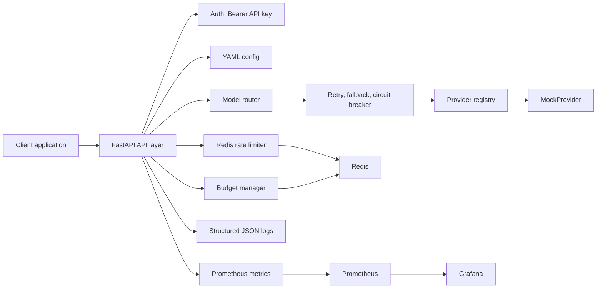
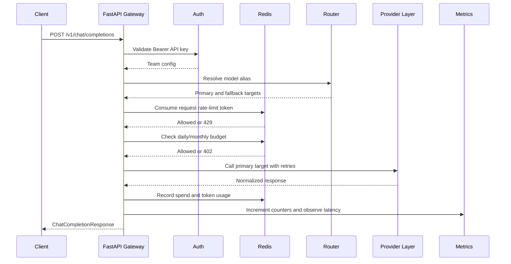
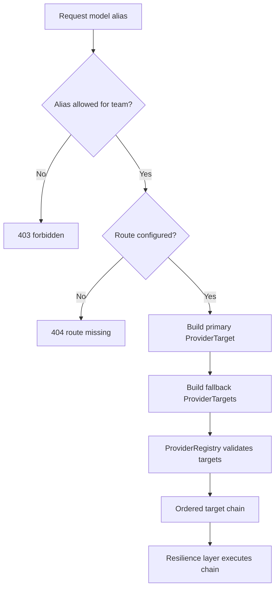
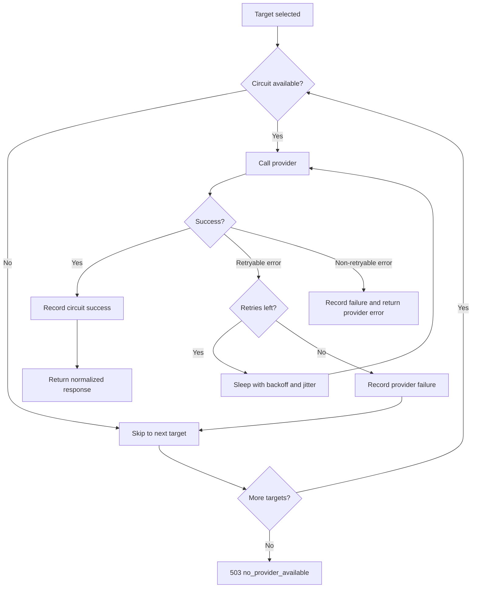
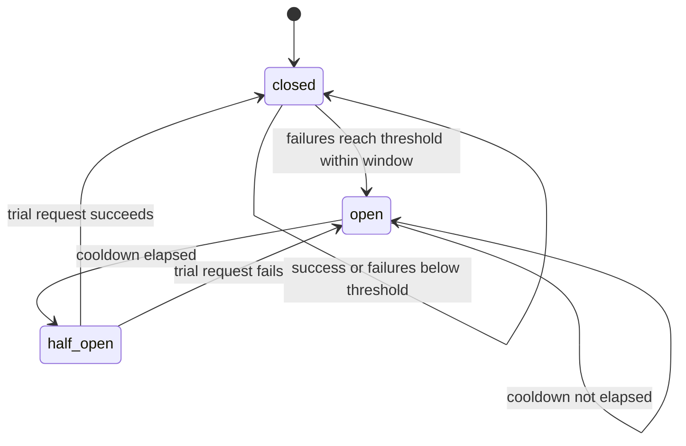
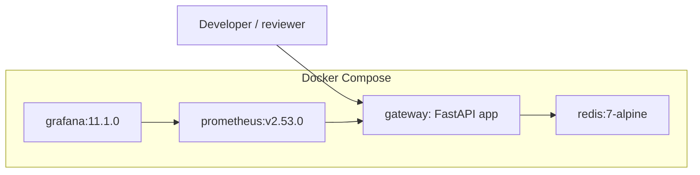

# Architecture

LLM Gateway is a FastAPI control plane for LLM traffic. It centralizes team authentication, model access control, model routing, provider abstraction, rate limiting, budget enforcement, resilience behavior, and observability.

The implementation is intentionally modular: API routes stay in `app/api`, authentication in `app/auth`, provider-specific logic in `app/providers`, routing and resilience in `app/routing`, Redis-backed limits in `app/rate_limit` and `app/budget`, and metrics/logging in `app/observability`.

## Overall Architecture



## Request Lifecycle



## Authentication boundaries

```mermaid
flowchart LR
    Reviewer -->|Admin access code once| Session[Signed HttpOnly admin session]
    Session --> Console[Teams, usage, providers]
    Session --> Grafana[Read-only Grafana]
    Application -->|Team Bearer key| Identity[/v1/me]
    Application -->|Team Bearer key| Chat[/v1/chat/completions]
    Developer -->|Local dev token| TestLab[/dev controls]
```

Data-plane team keys identify the calling team and constrain chat behavior. The separate control-plane session protects global operational metadata. Development controls remain a third, local-only credential so neither a team key nor a read-only admin session can mutate demo state.

## Provider Routing



## Retry And Fallback Flow



## Circuit Breaker State Machine



State values exposed through `llm_gateway_circuit_state`:

| State | Gauge value |
| --- | --- |
| `closed` | `0` |
| `open` | `1` |
| `half_open` | `2` |

## Docker Deployment



Exposed ports:

| Service | Port |
| --- | --- |
| Gateway | `8000` |
| Redis | `6379` |
| Prometheus | `9090` |
| Grafana | `3000` |

## Design Boundaries

- API routes do orchestration and response handling.
- Provider adapters do provider-specific calls and response normalization.
- Routing code owns alias resolution, retry, fallback, and circuit-breaker behavior.
- Redis is used for runtime rate-limit and budget state.
- Configuration is static YAML loaded by the application.
- Observability avoids high-cardinality labels and never records prompt content as metric labels.
