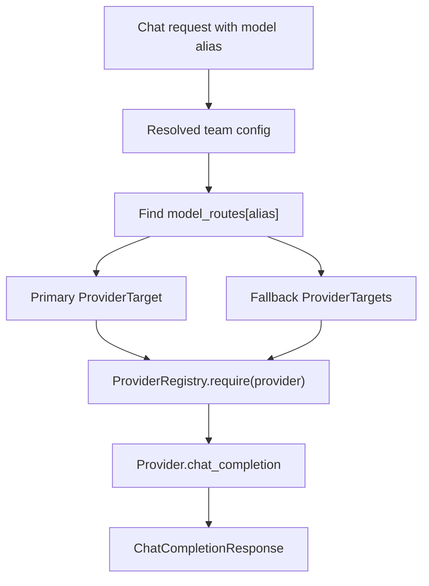

# Provider Abstraction

The provider layer keeps routing, retry, fallback, metrics, and budget logic provider-agnostic. The rest of the gateway deals with normalized internal contracts instead of provider-specific response shapes.

## Core Components

| Component | File | Responsibility |
| --- | --- | --- |
| `BaseProvider` | `app/providers/base.py` | Defines provider contract and response normalization helper |
| `ProviderTarget` | `app/providers/target.py` | Canonical `provider:model` target representation |
| `ProviderRegistry` | `app/providers/registry.py` | Owns provider registration, lookup, and target validation |
| `MockProvider` | `app/providers/mock_provider.py` | Deterministic reference provider for tests and local demos |
| Provider errors | `app/providers/errors.py` | Typed retryable and non-retryable failure classes |

## Provider Target Format

Routes are configured as separate provider/model fields:

```yaml
smart-chat:
  provider: mock
  model: mock-smart-chat
  fallbacks:
    - provider: mock
      model: mock-backup-chat
```

Internally, that becomes:

```text
mock:mock-smart-chat
```

`ProviderTarget` rejects malformed values such as missing provider, missing model, or surrounding whitespace.

## Provider Contract

Every provider must:

- set a stable `provider_name`
- implement `chat_completion(request, target)`
- validate that the target belongs to that provider
- return a normalized `ChatCompletionResponse`
- map provider failures into typed `ProviderError` subclasses

Providers may override:

- `validate_target(target)` for provider-specific model constraints
- `is_enabled()` for environment-gated providers

## Error Model

Retryable errors:

- `ProviderTimeoutError`
- `ProviderRateLimitError`
- `ProviderServerError`

Non-retryable errors:

- `ProviderAuthError`
- `ProviderConfigurationError`
- `ProviderUnavailableError`

Retryable errors can trigger retries and fallback. Non-retryable errors stop immediately because trying another target would hide a configuration or credential problem.

## Routing Interaction



## Adding A Provider Later

1. Create a provider class under `app/providers/`.
2. Subclass `BaseProvider`.
3. Set `provider_name` to the config slug.
4. Implement `chat_completion(request, target)`.
5. Convert provider-specific responses with `normalize_chat_response(...)`.
6. Convert provider-specific failures to typed provider errors.
7. Implement `is_enabled()` if real credentials or local services are required.
8. Add registration in `ProviderRegistry` only when the provider is safe to expose.
9. Add tests for disabled/no-env behavior and response normalization.

## Current Scope

The current project intentionally ships only `MockProvider`. That keeps the repository easy to run, avoids paid provider calls in tests, and makes failure behavior deterministic for retries, fallbacks, and circuit-breaker tests.

## Testing Rules

- Do not require real provider API keys.
- Do not make paid provider calls in tests.
- Keep `MockProvider` as the reference provider.
- Test provider target validation and registry behavior.
- If real adapters are added later, test disabled and mocked transport paths first.
